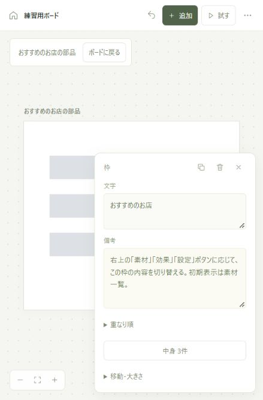

# UIBOARD / 作戦ボード

人間はブラウザ、AIはCLIから、同じUI設計を編集する独立したローカルアプリです。実装対象のプロジェクトとは別のフォルダで動かします。特定のAI製品のSDKやAPIキーは不要です。



## 起動

Node.js 22以降を使います。外部パッケージのインストールは不要です。

```powershell
git clone https://github.com/yunue2007/uiboard.git
cd uiboard
npm start
```

ブラウザで <http://127.0.0.1:4317> を開くとホームが表示されます。「新規作成」「開く」、保存したボード一覧、人間向け・AI向けチュートリアルから始められます。初回の保存済みボードにはカフェ予約のサンプルがあります。編集画面の左上の家のアイコンからホームに戻れます。

通常は起動したターミナルを開いたまま使います。終了は Ctrl+C。保存先は `data/board.json` です。複数のボードと各ボードの履歴を1つのファイルに保存し、次回起動時に復元します。上部のボード名を押すと一覧を開けます。新規作成・別名で保存でも元のボードは残ります。別サーバーとして分ける場合は、異なるポートとデータファイルを指定できます。

```powershell
node cli.mjs serve --port 4318 --data ./data/another-board.json --empty
```

`--empty` はデータファイルがない初回だけ使われます。既存データは上書きしません。

## 人間が使うUI

ホームの人間向けチュートリアルには、操作手順と「練習用ボードを作る」があります。練習は独立したボードで、既存の内容を残して作成します。ホームの「JSONから開く」も新しいボードとして読み込みます。

AI向けチュートリアルは、実際のCLI絶対パス、接続先、対象ボードIDと編集手順を入れた説明をコピーできます。CodexやClaudeなど、同じPCでCLIを実行できるAIへ依頼を添えて渡します。AIへ自動送信はしません。

- 「追加」から画面・文字・ボタン・入力欄・画像・枠を置く。
- 画面サイズはPC（1280×800）またはスマホ（390×844）。既存画面も、見出しを選んで切り替えられる。
- 部品をドラッグして配置し、右下をドラッグして大きさを決める。選択時の「移動・大きさ」ではボタンで8pxずつ調整できる。画面は見出しか「移動」で動かし、大きさはPC・スマホから選ぶ。
- 部品を選んだ時だけ、小さな編集欄が開く。「文字」「備考」「押したら移動する画面」を決める。
- 「試す」で画面のつながりを確認する。
- 画面・部品は複製アイコンかCtrl/⌘+Dで複製。内部IDを再発行し、自分自身への遷移は複製先へ、ほかの画面への遷移は元の行き先を維持する。
- 別案を並べる場合も普通の複製を使い、画面の名前と備考で違いを説明する。
- 同じ画面の部品をShift+クリックで複数選択すると整列できる。等間隔は3個以上。ドラッグ・矢印キーで一緒に移動できる。
- 部品編集の「重なり順」から前面・背面へ動かせる。
- CLIの変更箇所は約5秒間囲んで表示する。履歴と取り消しも引き続き使える。

## 見切れた部品と設計の点検

「その他 → 部品一覧」から、名前・種類・所属で部品を探せます。画面の編集欄には「部品一覧」、枠には「中身」があり、そこから中身だけを表示して編集できます。画面外や重なった部品も一覧から選択できます。この表示用の余白は保存座標へ加算されず、元の配置は保持されます。「ボードに戻る」で全体の設計図へ戻ります。

「その他 → 設計をチェック」は、開始画面からたどれない画面、所属先の表示範囲から完全に外れた部品を調べます。結果から対象へ移動できます。別案や意図した範囲外の配置もあるため、結果は要確認として表示し、自動では変更しません。複雑な動作やスクロール中の全状態を保証する検査ではありません。詳細は最大200件で、件数は全体を返します。

```powershell
node cli.mjs check --board board_12345678
```

`check` は読み取り専用です。要確認箇所があっても終了コードは0。`context` の `checks` と `GET /api/check` も同じ形式を返します。

ホームのボードごとの「… → アーカイブ」で通常一覧から退避し、「アーカイブ済み → 復元」で戻せます。設計・版・変更履歴・取り消し履歴は保持します。最後のボードを退避するとホームへ戻り、そのボードは読み取り専用になります。新規作成と復元は引き続き使えます。アーカイブは容量を減らす機能ではなく、保存上限の100件には退避したボードも含まれます。

## 枠にまとめて、備考で動きを伝える

枠に所属させた部品は、枠と一緒に移動・複製されます。枠の削除では中身も削除され、取り消しでまとめて復元できます。枠の入れ子は扱いません。

- 部品の「所属する枠」で所属を選ぶ。画面へ戻すこともでき、所属変更では表示位置を保つ。
- 枠を選んでから部品を追加すると、その枠の中に追加する。
- 枠の「中身」から一覧を開き、中身だけを表示して編集できる。
- 画面の「ここから始める」で開始画面を保存する。「試す」はその画面から始まる。

「試す」は画面遷移の確認用です。スクロール・折りたたみ・固定表示・枠内の切り替えは再現せず、備考で説明します。例えば「右上の素材・効果・設定ボタンに応じて、この枠の内容を切り替える。初期表示は素材」のように、操作と結果の対応を書きます。エディター・プレビュー・SVGは同じ固定配置を表示します。

CLIの部品のx/yは、所属する画面または枠の中の座標です。枠内の原点は32pxの見出しの直下です。`reparent` はこの座標を換算して表示位置を保持します。

```powershell
node cli.mjs tutorial
node cli.mjs add screen_settings card --id settings_region --label '設定の中身' --height 300 --remarks '項目が増えたら枠の中を縦スクロール'
node cli.mjs add screen_settings button --parent settings_region --x 16 --y 220 --label '保存' --remarks 'このボタンは枠の下に固定する'
node cli.mjs reparent settings_save settings_region
node cli.mjs start-screen screen_settings
node cli.mjs duplicate screen_settings --name '設定の別案'
```

画面・部品IDは実際のボードのものに置き換えてください。`node.reparent` は `{type, id, parentId}`、開始画面は `board.update` の `changes.startScreenId` を使います。

以前の `scroll`・`collapsible`・`collapsed`・`fixed` は互換データとして保存・読み込み・複製・履歴復元で保持します。既存の指定は編集欄と設計メモ、CLIの `legacyBehaviorNote` に文章で示します。通常の追加・変更でこれらを設定すると備考への記述を案内するエラーになります。旧JSONの読み込みは可能ですが、動作は再現しません。`duplicate --variant` も廃止し、普通の複製と名前・備考へ統合しました。保存済みの設計を自動で書き換える移行は行いません。

遷移線は元の部品の端から、移動先の画面の端までつながります。線を選ぶと、元の部品と移動先を強調します。画面・部品のドラッグ中も接続点が追従し、SVGへの書き出しでも同じ経路を使います。

余白をドラッグするとボードを移動できます。取り消しは上の矢印から。履歴・書き出し・AIへの接続手順などは「その他」にまとめています。

画面と部品は角丸なしの四角形です。画面は白、画像は薄い青、ボタンは薄いグレーで固定。表示色は部品を見分けるためのものです。実装時に使いたい色や形、画像の内容、動きなどは「備考」に書きます。備考はCLIの `note` と同じ項目で、既存のメモも引き継がれます。

位置の数値、部品ID、検討状態などは通常画面に表示しません。CLIでは引き続き読み書きできます。固定色と角丸の変更要求は拒否し、備考への記述を促します。古いボードのサイズ・座標・文言・備考は保持し、表示色と角丸だけを固定ルールに揃えます。サイズ切り替えで部品は自動再配置しません。

入力値は入力が約0.6秒止まった時か確定時（フォーカス移動・選択変更など）、ドラッグは手を離した時に保存されます。編集中の欄がある間に他者が変更した場合、古い版を使った保存は競合として止まります。

## Codex / Claudeなどから使うCLI

CLIは実行中の同じサーバーへ接続します。実装対象のプロジェクトのフォルダからも、CLIの絶対パスを指定して実行できます。

```powershell
$boardCli = 'C:\path\to\uiboard\cli.mjs'
node $boardCli context
node $boardCli inspect home_details
node $boardCli set home_details --label '詳細を見る →' --actor Codex
node $boardCli focus home_details --actor Codex
```

`context` にはボード概要、人間が選択中の画面・部品の詳細、AIの注目位置、版番号が含まれます。`focus` はUIで指定対象を選択・表示し、人間の選択記録とは分けて保持します。選択はサーバー稼働中の一時情報です。

`context` は `documentId` と人間が見ている範囲（`presence.human.viewport`）も返します。中身だけの表示中は `viewport.scopeId` が画面・枠のIDを示し、範囲は元のボード座標へ換算されます。ボード切替は同じサーバーを使う全クライアントで共有します。AIは確認したIDを `--board` に指定してください。別のボードが同じ版番号になっていても誤編集を防げます。ブラウザの表示位置と最後の選択はボードごと・タブごとに復元します。

```powershell
node cli.mjs boards
node cli.mjs boards --archived
node cli.mjs new-board --title '別の作戦'
node cli.mjs save-as --title '比較用のコピー'
node cli.mjs open board_12345678
node cli.mjs set home_details --label '詳細を見る' --board board_12345678 --revision 3
node cli.mjs duplicate screen_home --name 'ホームのエラー時の案'
node cli.mjs layer home_photo back
node cli.mjs layout left home_brand home_title
```

`open` のIDは `boards` で確認した実際のdocumentIdを使います。HTTPの変更・presence・ボード操作にもdocumentIdが必要です。

```powershell
node cli.mjs archive board_to_archive --board current_document_id --revision 3 --actor Codex
node cli.mjs restore board_to_archive --board current_document_id --revision 3 --actor Codex
```

`archive` / `restore` の引数は整理するボードのID、`--board` と `--revision` は操作前に確認した現在のボードです。現在のボードをアーカイブすると別の通常ボードへ切り替わることがあるため、次の操作前に `context` を読み直します。復元しただけでは別ボードへ切り替わりません。アーカイブ済みへの編集は409で拒否されます。

UIの変更はCLIで次に読んだ時に確認できます。CLIの変更と注目先は、開いているUIへSSEで反映されます。

```powershell
node cli.mjs list
node cli.mjs get
node cli.mjs add-screen --id screen_settings --name '設定' --x 1500
node cli.mjs add-screen --id screen_mobile --name 'スマホ画面' --preset mobile
node cli.mjs set screen_settings --preset pc
node cli.mjs set screen_settings --remarks '実装時の背景は紺色にする'
node cli.mjs add screen_settings button --id settings_save --label '保存' --x 24 --y 400
node cli.mjs set settings_save --note '保存後の動線を検討する' --status discuss
node cli.mjs link settings_save screen_home
node cli.mjs history --since 0
node cli.mjs undo --actor Claude
node cli.mjs redo --actor Claude
```

一覧・読み取り・編集結果はJSON。失敗はstderrのJSONと終了コード1で返します。別ポートは `--url http://127.0.0.1:4318` または `UIBOARD_URL`。表示するAI名は `--actor` または `UIBOARD_ACTOR` で設定します。

## 複数箇所を安全に変更する

`get` / `inspect` / `context` で読んだ版番号を明示すると、検討中に行われた他の編集を上書きせずに済みます。

```powershell
node cli.mjs set home_details --label 'お店の詳細へ' --revision 0 --actor Codex
```

読み取り後にボードが変わっていたらHTTP 409と現在の版番号を返し、変更は一切適用しません。再読み取りして意図を確認し、新しい編集を組み立てます。`--revision` を省略した単発コマンドも、実行中の競合を検出します。

一括編集は次のJSONをUTF-8で保存して使います。`baseRevision` は現在の読み取り結果に合わせます。

```json
{
  "documentId": "contextで確認したdocumentId",
  "baseRevision": 0,
  "operations": [
    { "type": "node.update", "id": "home_details", "changes": { "label": "詳細を見る →", "note": "予約までの動線の起点" } },
    { "type": "node.update", "id": "detail_book", "changes": { "status": "discuss" } }
  ]
}
```

```powershell
node cli.mjs apply --file patch.json --dry-run --actor Codex
node cli.mjs apply --file patch.json --actor Codex
```

`--dry-run` は検証と変更後の候補を返し、保存・履歴・UIを変更しません。本適用も版を再検証します。一括操作の一部が無効なら全体を適用しません。`--file -` は標準入力から読みます。

操作形式は `board.update`, `board.reset`, `board.import`, `screen.add`, `screen.update`, `node.add`, `node.update`, `item.remove`, `item.duplicate`, `node.layer`, `nodes.layout`。画面と部品の作成時にIDを指定できるので、同じ一括操作の中から参照できます。`screen.add` は `screen`、`node.add` は `screenId` と `node`、更新は `id` と `changes` を渡します。遷移先は部品の `targetScreenId`（解除はnull）です。

## 書き出し・復元

```powershell
node cli.mjs export --format json --out my-board.json
node cli.mjs export --format svg --out my-board.svg
node cli.mjs export --format brief --out my-board.md
node cli.mjs export --format bundle --out my-board.zip
node cli.mjs import --file my-board.json --actor Codex
```

`bundle` は同じ版の `board.json`、`board.svg`、`brief.md`、設計チェックの `checks.json`、版とdocumentIdを記した `manifest.json` をZIPにまとめます。PNG出力は含みません。

SVGは配置・文言・遷移の静的な図です。フォントの折り返しや線の経路はブラウザ表示と多少異なります。厳密な見た目はUI、構造・座標・メモの正確な受け渡しはJSONを使います。JSONの再読み込みで復元するのは設計本体です。変更履歴と取り消し履歴のバックアップには、停止後の `data/board.json` を保存してください。

取り消し・やり直しはUIとCLIで共通の直近操作が対象です。取り消しは最大100操作、表示履歴は最大200操作を保持します。版番号は取り消し後も増え続けます。`draft` / `discuss` / `confirmed` は設計の状態を示す情報で、編集ロックではありません。

## 構成と境界

```text
人間のブラウザUI ─┐
                  ├─ 共通API → 版の検査 → ローカル保存
AIのCLI ──────────┘       └─ 変更通知 → 開いているUI
```

標準のNode.js機能のみ使用。サーバーは127.0.0.1で待ち受け、外部公開しません。同じデータファイルを複数のサーバーが使わないようロックします。異常終了後は、起動時に終了済みプロセスのロックを検出して回復します。ロックの所有者を確認できない場合は自動削除しません。

この版では、固定座標の部品と画面遷移によるUI設計を扱います。画像はプレースホルダーで、業務処理・実プロジェクトのコード生成・外部AIへの自動問い合わせは含みません。AIは提供されたCLIを実行できる環境から参加します。WSLやコンテナなど別のネットワーク環境との接続は個別に設定が必要です。

## 検証

```powershell
npm run check
npm test
```

データ検証、一括操作の原子性、同時編集の競合、永続化、取り消し・やり直し、ロック、選択共有、CLIの別フォルダからの実行、SSE、HTTP境界、書き出し・読み込みを検証します。HTTPを使うテストにはローカルループバック通信の許可が必要です。

現在の確認内容と検証範囲は[検証記録](docs/VERIFICATION.md)を参照してください。
